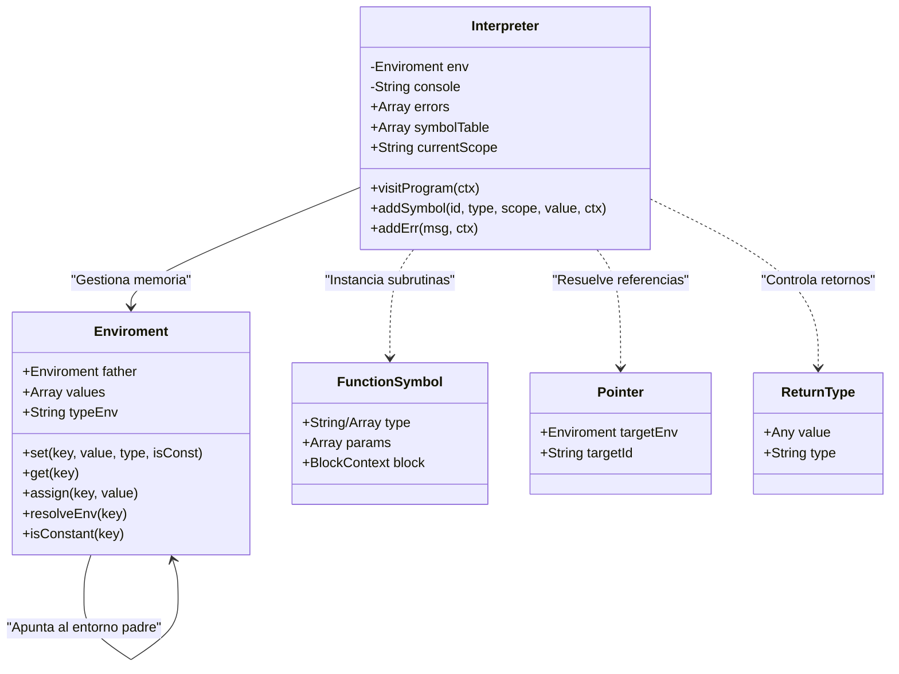
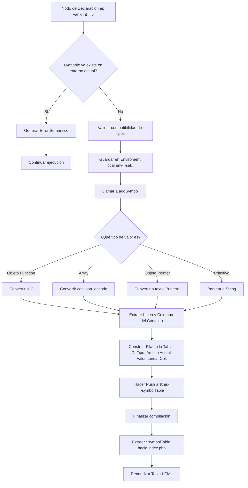

# 1. Arquitectura de la Gramática 

La gramática del lenguaje **Golampi** ha sido diseñada utilizando **ANTLR4**, implementando una arquitectura descendente recursiva (Top-Down Parser) con una clara separación entre el análisis léxico y el análisis sintáctico .

## 1.1. Análisis Léxico (Lexer)

El analizador léxico se encarga de agrupar los caracteres de entrada en componentes léxicos válidos , ignorando los espacios en blanco y los comentarios mediante el comando `-> skip`.

### Tokens de Palabras Reservadas y Operadores

Se definieron tokens estáticos para todas las palabras reservadas de Golampi y los símbolos de puntuación y operación:

* **Estructuras de Control:** `IF` (`if`), `ELSE` (`else`), `SWITCH` (`switch`), `CASE` (`case`), `DEFAULT` (`default`), `FOR` (`for`).
* **Declaración y Tipos:** `VAR` (`var`), `CONST` (`const`), `FUNC` (`func`). Los tipos soportados son: `INT_R` (`int`, `int32`), `FLOAT_R` (`float`, `float32`), `BOOL_R` (`bool`), `CHAR_R` (`char`, `rune`), `STRING_R` (`string`).
* **Operadores Matemáticos y Lógicos:** `PLUS` (`+`), `MINUS` (`-`), `MULT` (`*`), `DIV` (`/`), `MOD` (`%`), `AND` (`&&`), `OR` (`||`), `NOT` (`!`).
* **Operadores Relacionales y Asignación:** `EQUAL` (`=`), `COLON_EQUAL` (`:=`), `EQUALITY` (`==`), `INEQUALITY` (`!=`), `GREATER` (`>`), `LESS` (`<`), `ADD_ASSING` (`+=`), etc.
* **Funciones Nativas:** `FMT_PRINT` (`fmt.Println`, `println`), `LEN` (`len`), `NOW` (`now`), `SUBSTR` (`substr`), `TYPEOF` (`typeOf`).

### Expresiones Regulares (Patrones Dinámicos)

Para los tokens cuyo valor es variable, se utilizaron las siguientes expresiones regulares:

* **ID (Identificadores):** `[a-zA-Z_] [a-zA-Z0-9_]*`
> Acepta variables y funciones que inicien con letra o guion bajo, seguido de caracteres alfanuméricos.


* **INT (Enteros):** `[0-9]+`
> Secuencia de uno o más dígitos.


* **FLOAT (Decimales):** `[0-9]+ '.' [0-9]* ([eE] [+-]? [0-9]+)? | '.' [0-9]+ ([eE] [+-]? [0-9]+)?`
> Acepta notación decimal estándar (ej. `3.14`) y notación científica (ej. `2.5e-3`).


* **STRING (Cadenas):** `'"' (~["\r\n] | '\\' .)* '"'`
> Acepta cualquier texto delimitado por comillas dobles, soportando secuencias de escape internas (`\n`, `\"`).


* **CHAR (Caracteres):** `'\'' (~['\\\r\n] | '\\' .) '\''`
> Acepta un único carácter delimitado por comillas simples.


---

## 1.2. Análisis Sintáctico (Parser)

El parser toma el flujo de tokens y construye el árbol sintáctico. Se diseñó utilizando reglas de precedencia explícitas para las expresiones matemáticas y lógicas, garantizando que operaciones como la multiplicación se evalúen antes que la suma, sin caer en ambigüedades.

### Estructura Base

La regla de entrada principal es `program`, la cual espera una o más instrucciones (`statement`) seguidas del fin de archivo (`EOF`).

```antlr
program: statement+ EOF;

```

### 1.2.1. Sentencias (Statements)

La regla `statement` engloba todas las instrucciones válidas que pueden ejecutarse de manera independiente. Se implementaron etiquetas (`# NombreEtiqueta`) para facilitar la visita del AST en el código fuente de PHP (Intérprete).

Las sentencias principales incluyen:

* **Declaraciones:** `declareStmt` (var), `shortDecl` (:=), `constStmt` (constantes).
* **Asignaciones:** `assignStmt` (variables regulares y punteros), `arrayAssign` (modificación de matrices).
* **Control de Flujo:** `ifStmt`, `switchStmt`, `forStmt`.
* **Subrutinas:** `funcStmt` (creación de funciones), `funcAccess` (llamadas a funciones), `return_stmt`, `break_stmt`, `continue_stmt`.
* **Utilidades:** `printStmt`, incrementos (`++`) y decrementos (`--`).

### 1.2.2. Precedencia de Expresiones (Reglas en Cascada)

Para resolver correctamente la prioridad matemática y lógica, el diseño de expresiones se dividió jerárquicamente de menor a mayor precedencia:

1. `expression` / `logicOr`:  Operador `||`.
2. `logicAnd`:  Operador `&&`.
3. `expression_rational`: Operadores `==`, `!=`, `>`, `<`, `>=`, `<=`.
4. `expression_arithmetic`:  Operadores `+`, `-`.
5. `term`:  Operadores `*`, `/`, `%`.
6. `factor`: 
* Agrupación con paréntesis `( expression )`.
* Operadores Unarios: `-x`, `+x`, `!x`.
* Operadores de Punteros: `&x` (Referencia), `*x` (Desreferencia).
* Llamadas a funciones (`funcAccess`) y funciones nativas (`len`, `substr`, `now`, `typeOf`).
* Accesos a matrices (`arrayAccess`).
* Literales estáticos (Enteros, Strings, Booleanos, Nil, Arreglos literales).
* Identificadores de variables (`ID`).


### 1.2.3. Estructuras de Datos Avanzadas

**Arreglos (Matrices Multidimensionales):**
El lenguaje soporta la definición y el acceso a arreglos de 'n' dimensiones a través del uso recursivo de las reglas de contenido.

* La regla `arrayType` (`[ size ] type`) soporta tamaños dinámicos e infiere tipos anidados (ej. `[2][2]int`).
bloque:
```antlr
arrayContent
    : KEY_OPEN arrayValues COMMA? KEY_CLOSE 
    ;

```


**Punteros y Paso por Referencia:**
Para cumplir con los requerimientos de manejo de memoria, se implementaron reglas a nivel atómico en `factor` para capturar explícitamente el uso de referencias en funciones y reasignaciones:

* `AMPERSAND factor`: Convierte una variable en su dirección de memoria simulada (`&x`).
* `MULT factor`: Accede al valor real almacenado en una referencia simulada (`*x`).


# 2. Gramática en Notación BNF

La siguiente especificación utiliza la Notación Extendida de Backus-Naur (EBNF) para describir las reglas sintácticas del lenguaje Golampi.

### Leyenda de Notación

* `<...>` : Símbolo No Terminal (una regla que se compone de otras reglas).
* `"..."` : Símbolo Terminal (palabras reservadas, operadores o caracteres literales).
* `[ ... ]` : Elemento opcional (puede aparecer 0 o 1 vez).
* `{ ... }` : Repetición (puede aparecer 0 o más veces).
* `{ ... }+` : Repetición obligatoria (debe aparecer 1 o más veces).
* `|` : Alternativa lógica (OR).
* `::=` : Se define como.

---

### 2.1. Regla Principal y Sentencias

```ebnf
<program> ::= { <statement> }+ <EOF>

<statement> ::= <declareStmt> [ ";" ] 
              | <assignStmt> [ ";" ] 
              | <printStmt> [ ";" ] 
              | <constStmt> [ ";" ] 
              | <ifStmt> 
              | <switchStmt> 
              | <forStmt> 
              | <break_stmt> 
              | <continue_stmt> 
              | <arrayAssign> 
              | <funcStmt> 
              | <return_stmt> 
              | <increment> [ ";" ] 
              | <decrement> [ ";" ] 
              | <funcAccess> [ ";" ] 
              | <block>

<block> ::= "{" { <statement> } "}"

<printStmt> ::= ( "fmt.Println" | "println" ) "(" [ <exprList> ] ")"

```

### 2.2. Declaraciones y Variables

```ebnf
<declareStmt> ::= "var" <idList> <type> [ "=" <exprList> ] 
                | <idList> ":=" <exprList>

<constStmt> ::= "const" <ID> <typesStatics> "=" <expression>

<idList> ::= <ID> { "," <ID> }

```

### 2.3. Asignaciones

```ebnf
<assignStmt> ::= <assingExp> <typeAssing> <exprList>

<assingExp> ::= <arrayAccess> 
              | "*" <factor> 
              | <idList>

<typeAssing> ::= "=" | "+=" | "-=" | "*=" | "/=" | "%="

```

### 2.4. Estructuras de Control de Flujo

```ebnf
<ifStmt> ::= "if" [ <declareStmt> ";" ] <expression> <block> [ "else" <block> ]

<switchStmt> ::= "switch" <expression> "{" { <switchCase> } [ <caseDefault> ] "}"

<switchCase> ::= "case" <exprList> ":" { <statement> }

<caseDefault> ::= "default" ":" { <statement> }

<forStmt> ::= "for" <for_init> ";" <expression> ";" <forupdate> <block> 
            | "for" <expression> <block> 
            | "for" <block>

<for_init> ::= <declareStmt> | <assignStmt>

<forupdate> ::= <increment> | <decrement> | <assignStmt>

<break_stmt> ::= "break" [ ";" ]

<continue_stmt> ::= "continue" [ ";" ]

```

### 2.5. Funciones

```ebnf
<funcStmt> ::= "func" <ID> <funcParRet> <block>

<funcParRet> ::= <parameters> [ <result> ]

<parameters> ::= "(" [ <paramDcl> { "," <paramDcl> } ] ")"

<paramDcl> ::= <idList> <type>

<result> ::= <type> 
           | "(" <type> { "," <type> } ")"

<return_stmt> ::= "return" [ <exprList> ] [ ";" ]

<funcAccess> ::= <ID> "(" [ <exprList> ] ")"

```

### 2.6. Arreglos y Punteros

```ebnf
<arrayAssign> ::= <ID> <arrayDimension> <typeAssing> <expression> [ ";" ]

<arrayDimension> ::= { "[" <expression> "]" }+

<arrayLiteral> ::= <arrayType> <arrayContent>

<arrayContent> ::= "{" <arrayValues> [ "," ] "}"

<arrayValues> ::= ( <expression> | <arrayContent> ) { "," ( <expression> | <arrayContent> ) }

<arrayAccess> ::= <ID> { "[" <expression> "]" }+

<type> ::= <typesStatics> 
         | "*" <type> 
         | <arrayType>

<arrayType> ::= "[" [ <expression> ] "]" <type>

```

### 2.7. Expresiones y Operadores 

```ebnf
<exprList> ::= <expression> { "," <expression> }

<expression> ::= <logicOr>

<logicOr> ::= <logicOr> "||" <logicAnd> 
            | <logicAnd>

<logicAnd> ::= <logicAnd> "&&" <expression_rational> 
             | <expression_rational>

<expression_rational> ::= <expression_rational> ( "==" | "!=" | ">" | "<" | ">=" | "<=" ) <expression_arithmetic> 
                        | <expression_arithmetic>

<expression_arithmetic> ::= <expression_arithmetic> ( "+" | "-" ) <term> 
                          | <term>

<term> ::= <term> ( "*" | "/" | "%" ) <factor> 
         | <factor>

<factor> ::= "(" <expression> ")" 
           | "+" <factor> 
           | "-" <factor> 
           | "&" <factor> 
           | "*" <factor> 
           | "!" <factor> 
           | <literal> 
           | "now" "(" ")" 
           | "substr" "(" <exprList> ")" 
           | "typeOf" "(" <expression> ")" 
           | "len" "(" <expression> ")" 
           | <funcAccess> 
           | <arrayAccess> 
           | <ID>

<increment> ::= <ID> "++"

<decrement> ::= <ID> "--"

```

### 2.8. Tipos y Literales Lógicos (Lexer Base)

```ebnf
<literal> ::= <INT> | <FLOAT> | <STRING> | <CHAR> | "true" | "false" | "nil" | <arrayLiteral>

<typesStatics> ::= "int" | "int32" | "float" | "float32" | "bool" | "char" | "rune" | "string"

<ID> ::= Letra o guion bajo seguido de caracteres alfanuméricos.
<INT> ::= Secuencia de uno o más dígitos [0-9].
<FLOAT> ::= Dígitos con punto decimal, soporta notación científica (ej. 1.5e3).
<STRING> ::= Secuencia de caracteres delimitada por comillas dobles (").
<CHAR> ::= Un único carácter delimitado por comillas simples (').

```

---

# 3. Arquitectura del Sistema y Procesamiento

El intérprete Golampi está diseñado bajo el patrón **Visitor**, recorriendo el Árbol de Análisis Sintáctico (AST) generado por ANTLR4. Para lograr la ejecución dinámica, se diseñó un ecosistema de clases auxiliares que simulan el comportamiento de la memoria RAM, los punteros y las subrutinas.

## 3.1. Diagrama de Clases 

El siguiente diagrama ilustra la relación entre el núcleo del intérprete y sus estructuras de datos internas.



### Descripción de Clases Principales

1. **`Interpreter`**: Clase principal que hereda de `GolampiBaseVisitor`. Coordina las visitas a los nodos del AST, gestiona el flujo de ejecución, captura la salida de consola y compila los reportes de errores y símbolos.
2. **`Enviroment`**: Simula los marcos de pila  de la memoria. Funciona como una lista enlazada (a través de la propiedad `father`), permitiendo que las variables locales oculten a las globales sin destruirlas. Controla los tipos de bloque (`GLOBAL`, `FUNCTION`, `LOOP`, `BLOCK`) y restringe la mutabilidad de constantes.
3. **`Pointer`**: Estructura crítica para el paso por referencia (`&` y `*`). En lugar de guardar un valor, guarda una referencia directa al entorno de memoria (`targetEnv`) y al identificador exacto (`targetId`) de la variable original.
4. **`FunctionSymbol`**: Almacena la "receta" de una función (su bloque de código en el AST y sus parámetros esperados) para ser invocada múltiples veces más adelante en el flujo.

---

## 3.2. Flujo de Procesamiento: Tabla de Símbolos

La Tabla de Símbolos en este intérprete no es estática; es un **registro histórico dinámico**. Debido a que los entornos (`Enviroment`) se crean y destruyen dinámicamente al entrar y salir de bloques funcionales o cíclicos, el intérprete debe "atrapar" la información de las variables en el momento exacto de su nacimiento.

### Mecanismo de Rastreo

El intérprete utiliza la variable pública `$currentScope` para saber exactamente en qué bloque lógico se encuentra la ejecución.

* Al iniciar, `$currentScope` es `"global"`.
* Al entrar a la función principal, cambia a `"main"`.
* Al invocar una función (ej. `fibonacci(n)`), cambia al nombre de dicha función (`"fibonacci"`).
* Al terminar el bloque `finally`, se restaura al scope anterior.

### Algoritmo de Registro (`addSymbol`)

Cada vez que se ejecuta una instrucción de declaración (`visitVarDecl`, `visitShortDecl`, `visitConstDecl`, `visitFuncStmt` o el mapeo de parámetros en `visitFuncCallExpr`), se invoca al método `addSymbol`.

Este método realiza un formateo de "Traducción Visual" para asegurar que objetos complejos de PHP puedan ser renderizados en la tabla HTML final:

* **Funciones:** Se omiten valores (`-`).
* **Arreglos:** Se convierten a cadenas JSON (`[1, 2, 3]`).
* **Punteros:** Se abstraen a la etiqueta textual `"Puntero"`.
* **Booleanos:** Se traducen explícitamente a `"true"` o `"false"`.
* **Nulos:** Se traducen a `"nil"`.

### Diagrama de Flujo (Registro de Símbolo)

El siguiente diagrama muestra el ciclo de vida de una variable desde su lectura en el AST hasta su integración en el reporte final de símbolos.

