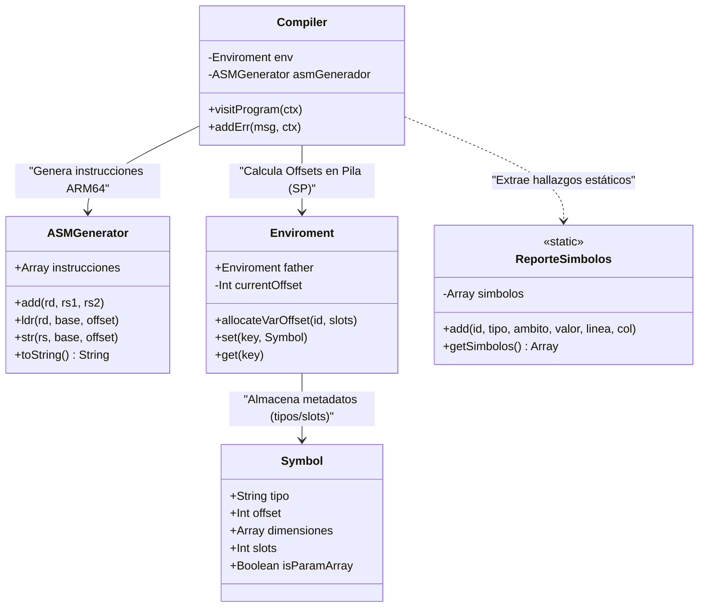
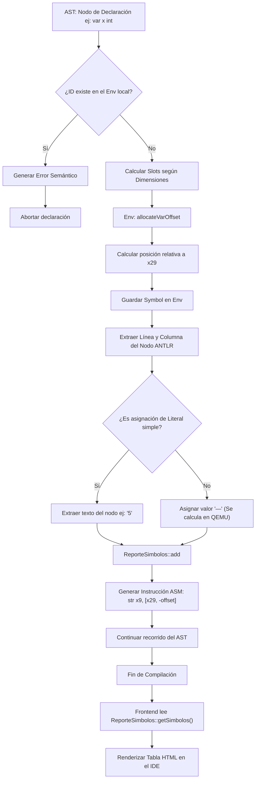

# Manual Técnico: Compilador Golampi (ARM64)

## 1. Arquitectura de la Gramática 

La gramática del lenguaje **Golampi** ha sido diseñada utilizando **ANTLR4**, implementando una arquitectura descendente recursiva (Top-Down Parser) con una clara separación entre el análisis léxico y el análisis sintáctico.

### 1.1. Análisis Léxico (Lexer)
El analizador léxico se encarga de agrupar los caracteres de entrada en componentes léxicos válidos, ignorando los espacios en blanco y los comentarios mediante el comando `-> skip`.

**Tokens de Palabras Reservadas y Operadores**
* **Estructuras de Control:** `IF` (`if`), `ELSE` (`else`), `SWITCH` (`switch`), `CASE` (`case`), `DEFAULT` (`default`), `FOR` (`for`).
* **Declaración y Tipos:** `VAR` (`var`), `CONST` (`const`), `FUNC` (`func`). Los tipos soportados son: `INT_R` (`int`, `int32`), `FLOAT_R` (`float`, `float32`), `BOOL_R` (`bool`), `CHAR_R` (`char`, `rune`), `STRING_R` (`string`).
* **Operadores Matemáticos y Lógicos:** `PLUS` (`+`), `MINUS` (`-`), `MULT` (`*`), `DIV` (`/`), `MOD` (`%`), `AND` (`&&`), `OR` (`||`), `NOT` (`!`).
* **Operadores Relacionales y Asignación:** `EQUAL` (`=`), `COLON_EQUAL` (`:=`), `EQUALITY` (`==`), `INEQUALITY` (`!=`), `GREATER` (`>`), `LESS` (`<`), `ADD_ASSING` (`+=`), etc.
* **Funciones Nativas:** `FMT_PRINT` (`fmt.Println`, `println`), `LEN` (`len`), `NOW` (`now`), `SUBSTR` (`substr`), `TYPEOF` (`typeOf`).

**Expresiones Regulares (Patrones Dinámicos)**
* **ID (Identificadores):** `[a-zA-Z_] [a-zA-Z0-9_]*`
* **INT (Enteros):** `[0-9]+`
* **FLOAT (Decimales):** `[0-9]+ '.' [0-9]* ([eE] [+-]? [0-9]+)? | '.' [0-9]+ ([eE] [+-]? [0-9]+)?`
* **STRING (Cadenas):** `'"' (~["\r\n] | '\\' .)* '"'`
* **CHAR (Caracteres):** `'\'' (~['\\\r\n] | '\\' .) '\''`

---

### 1.2. Análisis Sintáctico (Parser)
El parser toma el flujo de tokens y construye el Árbol de Análisis Sintáctico (AST). Se diseñó utilizando reglas de precedencia explícitas para las expresiones matemáticas y lógicas, garantizando que operaciones como la multiplicación se evalúen antes que la suma.

#### Precedencia de Expresiones (Reglas en Cascada)
Para resolver correctamente la prioridad matemática y lógica, el diseño de expresiones se dividió jerárquicamente de menor a mayor precedencia:
1. `expression` / `logicOr`:  Operador `||`.
2. `logicAnd`:  Operador `&&`.
3. `expression_rational`: Operadores `==`, `!=`, `>`, `<`, `>=`, `<=`.
4. `expression_arithmetic`:  Operadores `+`, `-`.
5. `term`:  Operadores `*`, `/`, `%`.
6. `factor`:  Agrupación `()`, Unarios (`-x`, `!x`), Punteros (`&x`, `*x`), Nativas, Arreglos y Literales.

---

## 2. Gramática en Notación BNF (EBNF)

### 2.1. Regla Principal y Sentencias
```ebnf
<program> ::= { <statement> }+ <EOF>

<statement> ::= <declareStmt> [ ";" ] 
              | <assignStmt> [ ";" ] 
              | <printStmt> [ ";" ] 
              | <constStmt> [ ";" ] 
              | <ifStmt> 
              | <switchStmt> 
              | <forStmt> 
              | <break_stmt> 
              | <continue_stmt> 
              | <arrayAssign> 
              | <funcStmt> 
              | <return_stmt> 
              | <increment> [ ";" ] 
              | <decrement> [ ";" ] 
              | <funcAccess> [ ";" ] 
              | <block>
```

### 2.2. Declaraciones, Tipos y Funciones
```ebnf
<declareStmt> ::= "var" <idList> <type> [ "=" <exprList> ] 
                | <idList> ":=" <exprList>

<funcStmt> ::= "func" <ID> <funcParRet> <block>

<arrayType> ::= "[" [ <expression> ] "]" <type>
<type> ::= <typesStatics> | "*" <type> | <arrayType>
```


---

## 3. Arquitectura del Sistema y Procesamiento Múltiple

A diferencia de un intérprete, este compilador no ejecuta el código mientras lo lee. El sistema está diseñado bajo el patrón **Visitor** para recorrer el AST, realizar análisis semántico estático y, simultáneamente, **generar código de máquina (ARM64)** calculando direcciones de memoria física simuladas en la pila (Stack) y el montículo (Heap).

### 3.1. Diagrama de Clases del Compilador

El siguiente diagrama ilustra la relación entre el núcleo del compilador, la gestión de memoria estática y la generación de ensamblador.



**Descripción de Clases Principales:**
1. **`Compiler`**: Orquesta el recorrido del AST. En lugar de resolver valores, traduce la lógica matemática y de control a llamadas de registros (ej. `x9`, `x10`).
2. **`ASMGenerador`**: Interfaz constructora de código ensamblador nativo. Gestiona operaciones de registros, saltos condicionales (branching) y cadenas almacenadas en `.rodata`.
3. **`Enviroment`**: Gestiona el marco de pila local. En lugar de guardar valores reales, **asigna y calcula Offsets** (espacios relativos al puntero `x29`/Frame Pointer) para cada variable, reservando `16 bytes` por slot para alineación de ARM64.
4. **`ReporteSimbolos`**: Clase estática recolectora que atrapa los metadatos de las variables descubiertas durante la compilación para generar el reporte visual.

---

## 3.2. Flujo de Procesamiento: Tabla de Símbolos Estática

En un intérprete, la tabla de símbolos captura el estado vivo de las variables. En este compilador, la Tabla de Símbolos es un **Registro de Análisis Estático**. 

Debido a que los valores reales de las variables no se conocen hasta que el procesador ejecuta el `.s` en QEMU, el compilador registra las variables en la tabla durante el tiempo de análisis (Compile Time), atrapando el tipo de dato, la ubicación en el código fuente y el ámbito al que pertenecen, asignando valores abstractos (como `"—"`) para aquellas expresiones que requieren cálculos en tiempo de ejecución.

### Diagrama de Flujo (Generación de Tabla de Símbolos)

El siguiente flujo demuestra cómo el compilador intercepta las declaraciones en el AST y alimenta la tabla de manera estática antes de escupir el código ensamblador.

