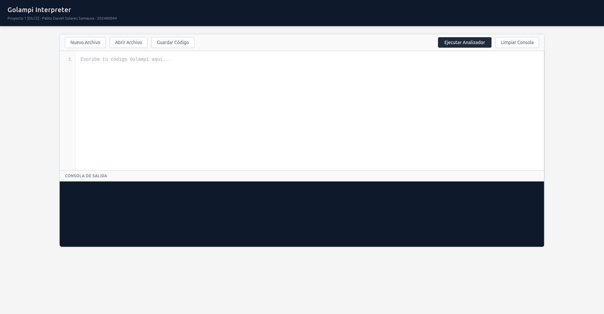
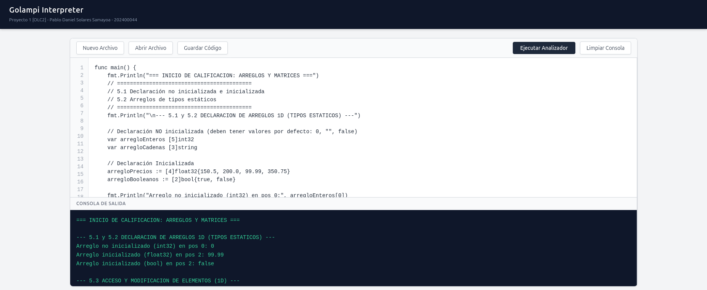
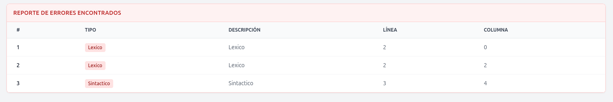
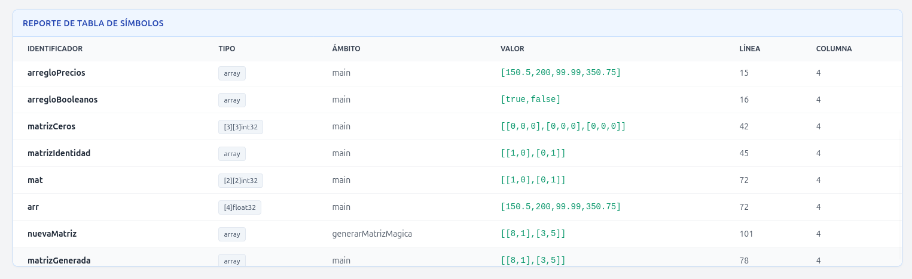

# Manual de Usuario - Intérprete Golampi

## 1. Instalación y Requisitos Previos

Para ejecutar el entorno de desarrollo (IDE) de Golampi, necesitas tener PHP y Composer instalados en tu sistema.

1. Abre una terminal en la carpeta raíz del proyecto.
2. Ejecuta el comando `composer install` para descargar las dependencias de ANTLR4.
3. Inicia el servidor integrado de PHP ejecutando el siguiente comando en la carpeta de tu proyecto:
`php -S localhost:8000`
4. Abre tu navegador web y dirígete a `http://localhost:8000`.

## 2. Conociendo la Interfaz

El IDE de Golampi está diseñado para ser minimalista e intuitivo. Se divide en tres áreas principales:

* **Barra de Herramientas (Superior):** Botones de control de archivos y ejecución.
* **Área de Trabajo (Izquierda):** Editor de código con numeración de líneas y la Consola de Salida.
* **Panel de Reportes (Derecha/Abajo):** Tablas dinámicas de estado que se generan tras la ejecución.

## 3. Crear, Editar y Ejecutar Código

### 3.1. Gestión de Archivos

En la barra de herramientas superior tienes opciones para manejar tu código sin necesidad de usar editores externos:

* **Nuevo Archivo:** Limpia el editor y la consola para empezar desde cero (te pedirá confirmación para no perder datos).
* **Abrir Archivo:** Abre el explorador de archivos de tu sistema operativo para cargar archivos de texto plano (ej. `.gl`, `.go`, `.txt`) directamente al editor.
* **Guardar Código:** Descarga el texto actual del editor como un archivo llamado `codigo.gl` en tu computadora.

### 3.2. Escribir y Ejecutar

1. Escribe tu código Golampi en el **Editor de Código**. El editor soporta el uso de la tecla `Tab` para facilitar la indentación.
2. Haz clic en el botón oscuro **"Ejecutar Analizador"**.
3. El intérprete evaluará el código. Si hay instrucciones de impresión (`fmt.Println`), el resultado se mostrará inmediatamente en la **Consola de Salida** (panel oscuro inferior).

## 4. Interpretación de Reportes

Al ejecutar el código, el sistema compila y analiza el flujo, generando tablas visuales en la parte inferior de la página para facilitar la depuración.

### 4.1. Reporte de Errores Encontrados

El intérprete cuenta con un modo de "Recuperación de Errores". Si tu código contiene operaciones inválidas, el programa no se detendrá bruscamente, sino que recolectará los fallos y mostrará una tabla con detalles precisos:

* **Tipo:** Categoría del fallo (Léxico, Sintáctico o Semántico).
* **Descripción:** Explicación del fallo 
* **Línea y Columna:** Ubicación exacta en tu código para una corrección rápida.

### 4.2. Reporte de Tabla de Símbolos

Si la ejecución declara variables, constantes, funciones o matrices, se generará una tabla detallando el estado histórico de la memoria:

* **Identificador:** El nombre asignado a la variable o función.
* **Tipo:** El tipo de dato (ej. `int32`, `string`, `pointer`).
* **Ámbito:** El contexto donde existe (ej. `global`, `main`, o dentro del nombre de una función específica).
* **Valor:** El contenido almacenado (las matrices se muestran en formato JSON y los booleanos como texto).
* **Línea / Columna:** Ubicación de su declaración original.

---
